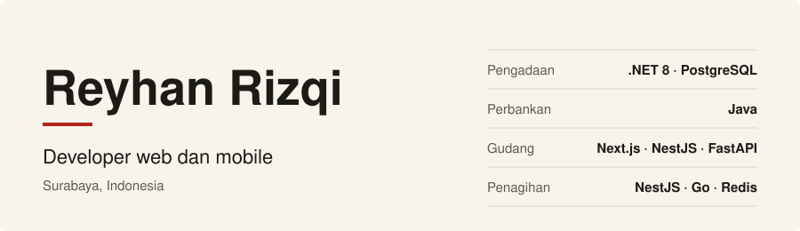

Saya paling sering membangun sistem untuk urusan bisnis: pengadaan barang, gudang, penagihan, pencatatan transaksi bank, dan perawatan aset. Di luar itu saya menulis bot dan skrip otomasi untuk pekerjaan yang berulang.

[Portfolio](https://porto-fullstack-reyhan-e4nx.vercel.app)

## Sorotan

<table>
<tr>
<td>
<h3><a href="https://github.com/reyhanzhan/sistem_pengadaan_barang">sistem_pengadaan_barang</a></h3>

Sistem e-procurement B2B multi-tenant. Clean Architecture dengan CQRS, autentikasi JWT, otorisasi berbasis policy, background service, dan unit test.

.NET 8 · MediatR · EF Core · PostgreSQL · xUnit
</td>
</tr>
</table>

## Sistem bisnis lainnya

## Sistem bisnis lainnya

| Proyek | Isi | Stack |
|---|---|---|
| [java_banking](https://github.com/reyhanzhan/java_banking) | Layanan inti perbankan mini. Transfer antar rekening dengan buku besar double-entry, transaksi ACID, penguncian pessimistic, dan idempotency key agar transfer tidak terproses dua kali. | Java |
| [sistem_manajemen_gudang_forecasting](https://github.com/reyhanzhan/sistem_manajemen_gudang_forecasting) | Manajemen stok banyak gudang dengan peramalan permintaan dan deteksi anomali. | Next.js, NestJS, PostgreSQL, Redis, FastAPI, Prophet |
| [saas_API_monetization](https://github.com/reyhanzhan/saas_API_monetization) | Platform penagihan berbasis pemakaian API: validasi API key, rate limit, dan tagihan bulanan. | Next.js, NestJS, Go, PostgreSQL, Redis, RabbitMQ |
| [maintenance_ac_fiks](https://github.com/reyhanzhan/maintenance_ac_fiks) | Pencatatan dan pelaporan perawatan unit AC di beberapa rumah sakit, dengan panel admin dan alur kerja koordinator. Versi mobile-nya ada di [maintenance_ac_mobile](https://github.com/reyhanzhan/maintenance_ac_mobile). | PHP, Blade, Flutter |

## Bot dan otomasi

| Proyek | Isi | Stack |
|---|---|---|
| [autotrade](https://github.com/reyhanzhan/autotrade) | Bot trading Binance Futures dengan strategi SMC/ICT dan dasbor untuk memantau posisi. Default-nya jalan di testnet dan dry-run. | TypeScript, Next.js, Prisma, PM2 |
| [auto_forex](https://github.com/reyhanzhan/auto_forex) | Bot MT5 untuk akun demo: bias tren H4, deteksi order block, risiko 1% per transaksi, dan jeda saat berita berdampak tinggi. | Python |
| [auto-send-wa](https://github.com/reyhanzhan/auto-send-wa) | Pengiriman pesan WhatsApp terjadwal lewat Cloud API resmi Meta. Penjadwalnya GitHub Actions, jadi tanpa server. | Node.js, Python, GitHub Actions |
| [share-platform](https://github.com/reyhanzhan/share-platform) | Tempel link live, pilih platform, lalu sebarkan. Tanpa API dan tanpa token. | HTML, CSS, JavaScript |

## Yang saya pakai

<table>
<tr>
<td><b>Bahasa</b></td>
<td></td>
</tr>
<tr>
<td><b>Web dan mobile</b></td>
<td></td>
</tr>
<tr>
<td><b>Data dan antrean</b></td>
<td></td>
</tr>
<tr>
<td><b>Deploy</b></td>
<td></td>
</tr>
</table>
